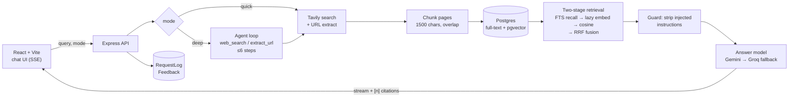

# Gaminai

A web research assistant that answers with **numbered, checkable citations**, plus an agentic **Deep research** mode for questions that need several searches. Every change to the answer pipeline is measured against a 100-question evaluation set.

**[Try it as a guest](https://gaminai-alpha.vercel.app)** (no sign-up) · **[Evaluation results](https://gaminai-alpha.vercel.app/evals)**

Runs entirely on free tiers: Vercel, Render, Supabase (Postgres + pgvector), Gemini/Gemma, NVIDIA, Groq and Tavily.

## What it does

- **Quick answers with citations.** One web search, then retrieval over the full page text, then an answer where every sentence that uses a source carries `[n]`. In the UI, each `[n]` is a chip linking to its source.
- **Deep research.** A tool-calling agent (AI SDK) breaks the question into sub-questions, runs `web_search` / `extract_url` until the passages cover them, then the normal cited-answer step writes the reply. Each step streams live into the answer's research trace. Hard limits: 6 steps, 60 s and a token budget per question.
- **URL-aware.** Paste a link and that page is read and treated as the primary source.
- **Verified images.** Image links are checked before the model can use them, so it only embeds images that actually load.
- **Prompt-injection guard.** Text on fetched pages is data, never instructions: instruction-like sentences are stripped before they reach a prompt, and a canary eval set measures how often a planted instruction gets through.
- **Provider fallback.** Answers stream from Gemini Flash-Lite, then fall back to Gemma 4, NVIDIA Nemotron and Groq if a model fails before its first token (each free tier runs out differently).
- **MCP server.** The same pipeline as a `gaminai_research(query, mode)` tool for Claude Desktop, Cursor or any MCP client.
- **Tracing.** Optional Langfuse tracing over OpenTelemetry: one trace per request (user, conversation, route, mode) containing every model call (follow-up rewrite, Deep-mode planner steps, answer) with prompts, outputs, latency and token usage.
- **Ops.** Every request is logged (model, fallback, latency, time to first token, tokens, research steps); an admin dashboard shows the trends, and thumbs-down answers can be turned into new eval cases with one click.

## Architecture



**Why two-stage retrieval:** the free Gemini embedding tier allows 1,000 texts a day. Embedding every chunk of every fetched page would use that up in about 20 questions, so Postgres full-text search recalls the top 12 candidates first and only those get embedded (cached per chunk). The cosine ranking and the full-text ranking are then merged with reciprocal rank fusion.

**Provider fallback:** answers stream from Gemini and fall back to Groq if Gemini fails before the first token (after that, switching would garble the stream). Groq's free tier rejects any request over 7k input tokens a minute, which is why Deep mode's prompt is capped at 10 passages.

## Evaluation

`Backend/evals` runs the real pipeline headless over 100 questions in four buckets (35 factual, 25 multi-hop, 20 URL-focused, 20 false-premise traps). A judge on a different model grades each answer against human-written key facts and against the passages the model was given.

| Run | Context the model sees | Correct | Faithful | Cites a source | Citation precision | p50 latency |
|---|---|---|---|---|---|---|
| Baseline | 600-char search snippets, no citation prompt | 98.3% | 97.0% | 1% | n/a | 1.5 s |
| + numbered citations | snippets | 94.9% | 98.6% | 100% | 99.2% | 1.8 s |
| + full-page chunks | full-text retrieval | 96.7% | 94.8% | 99% | 98.5% | 1.6 s |

What moved and what didn't:
- **Citations went from 1% to 99–100% of answers**, and the judge found that 98–99% of `[n]` markers point at a passage that actually supports the sentence.
- **Full page text helped URL-focused questions** (82.9% → 90.8% correct vs snippets) but **hurt multi-hop faithfulness** (94.3% → 85.1%): the model drew on more passages and made more claims they didn't fully support. That's the gap hybrid retrieval and Deep mode are meant to close; their runs are next.
- Overall correctness sits near the ceiling, so this set is too easy to show correctness gains; the signal is in citations and faithfulness.

Caveats, stated plainly: the baseline used an earlier search cache, so the fair comparisons are between the citation runs. The "+ numbered citations" run is being re-run because part of it was graded before a judge-prompt fix. The judge is being calibrated against 30 hand-labelled answers (Cohen's κ).

A GitHub Actions workflow runs a 20-question smoke subset on pull requests that touch the answer pipeline and fails if correctness or faithfulness drops more than 5 points against the baseline.

## Stack

TypeScript everywhere. **Backend:** Express 5, Vercel AI SDK (Gemini, NVIDIA, Groq), MCP SDK, Langfuse + OpenTelemetry, Prisma 7, Postgres with pgvector, Tavily, Zod, Vitest. **Frontend:** React 19, Vite, Tailwind 4, Supabase Auth.

## Run it locally

```bash
cd Backend && npm install && cp .env.example .env   # fill in the keys
npx prisma migrate deploy && npx prisma generate
npm run dev                                         # API on :8000
cd ../Frontend/Gaminai && npm install && npm run dev  # app on :5173
```

```bash
cd Backend && npm test                                       # 45 unit tests, no network
cd Backend && npm run eval -- --label my-run --retrieval hybrid   # full eval (uses API quota)
cd Backend && npm run eval -- --dataset canary --label canary     # prompt-injection canary set
cd Backend && npm run eval -- --bucket multi_hop --deep --label deep   # Deep vs Quick
```

### Use it from Claude Desktop or Cursor (MCP)

Add this to the client's MCP config (`claude_desktop_config.json` or `.cursor/mcp.json`), with your own path to `Backend/`:

```json
{
  "mcpServers": {
    "gaminai": {
      "command": "node",
      "args": [
        "C:/path/to/Gaminai/Backend/node_modules/ts-node/dist/bin.js",
        "--transpile-only",
        "C:/path/to/Gaminai/Backend/mcp.ts"
      ]
    }
  }
}
```

It reads keys from `Backend/.env`, so it works from any folder.
